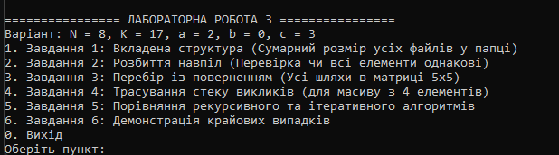

N = 8, K = 17, a = 2, b = 0, c = 3

## Опис базових випадків рекурсії

- **Завдання 1 (`GetDirectorySize`):** Базовий випадок є неявним — це підпапка, яка не містить у собі інших підпапок та файлів, у результаті чого цикли обходу завершуються без виконання подальших рекурсивних викликів.
- **Завдання 2 (`AreAllEqualRecursive`):** Базовим випадком є підмасив, що складається з одного елемента (`lo == hi`), який за визначенням є однаковим із самим собою і повертає `true`.
- **Завдання 3 (`FindMatrixPaths`):** Базовим випадком є досягнення нижньої правої клітинки матриці (`r == M - 1` та `c == M - 1`), після чого поточний шлях виводиться й рекурсія повертається назад.

---

## Завдання 4 · Вивід трасування стеку викликів

```text
enter AreAllEqual(0..3)
  enter AreAllEqual(0..1)
    enter AreAllEqual(0..0) -> True
    enter AreAllEqual(1..1) -> True
  exit  AreAllEqual(0..1) -> True
  enter AreAllEqual(2..3)
    enter AreAllEqual(2..2) -> True
    enter AreAllEqual(3..3) -> True
  exit  AreAllEqual(2..3) -> True
exit  AreAllEqual(0..3) -> True

